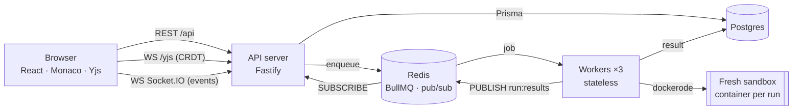

# CodeSync

**A real-time collaborative code editor: several people edit the same file with live cursors, and anyone can hit Run to execute it in an isolated Docker sandbox. Everyone in the room sees the output.**


> **Live demo:** https://codesync.172-198-73-199.sslip.io (sign up, create a room, open the invite link in a second window)
>
> The demo VM is stopped when idle to save cost; the GIF above shows it running.

- **Real-time editing** with a CRDT (Yjs): no conflicts, works offline and syncs on reconnect.
- **Live cursors and presence**, coloured per user.
- **Sandboxed execution** for Python 3.12, JavaScript (Node 20) and C++ (GCC 13). Every run gets a fresh container with no network, 128 MB RAM, 0.5 CPU and a 5 s limit.
- **Queue + horizontally scalable workers** (BullMQ). Results fan out to every browser via Redis pub/sub and Socket.IO.
- **Hardened API**: cookie JWT auth, roles (owner / editor / viewer), a hand-written Redis sliding-window rate limiter, a queue-length guard, structured logs with request IDs, and graceful shutdown.
- **Tested**: 86 unit/integration tests (the sandbox tests use real Docker), Playwright E2E with two users, and k6 load tests with [documented numbers](docs/benchmarks.md).

---

## Architecture



**Run flow**

1. The browser sends `POST /api/rooms/:roomId/runs` with `{ language, code }`.
2. The API checks auth, role (editor or owner), the rate limit (10/min/user), code size (≤ 50 KB, else 413) and queue length (else 503). It then inserts a `Run` row as `QUEUED`, enqueues a BullMQ job and returns **`202 { runId }`**.
3. A worker takes the job, marks the run `RUNNING`, and starts a **fresh container**. The code goes in via stdin, never through a shell string.
4. The worker stores `SUCCESS | ERROR | TIMEOUT` with stdout/stderr/exit code/duration, and publishes the result on the Redis channel `run:results`.
5. Every API instance is subscribed to that channel. Each one emits `run:update` to its Socket.IO room, so **everyone in the room** sees the output.

Detailed diagrams (sequence, state machine, sync internals): **[docs/architecture.md](docs/architecture.md)**.

## Tech stack

| Layer                         | Choice                                                              |
| ----------------------------- | ------------------------------------------------------------------- |
| Language                      | TypeScript everywhere (`strict`, `noUncheckedIndexedAccess`)        |
| Monorepo                      | pnpm workspaces: `apps/{web,server,worker}`, `packages/{shared,db}` |
| Frontend                      | React 18, Vite, Monaco, Tailwind                                    |
| Collaboration                 | Yjs + y-monaco + y-websocket protocol (custom server)               |
| Events                        | Socket.IO                                                           |
| API                           | Fastify 5, Zod schemas shared with the client                       |
| Data                          | PostgreSQL + Prisma                                                 |
| Queue / pub-sub / rate limits | Redis + BullMQ                                                      |
| Execution                     | Worker service with dockerode                                       |
| Tests                         | Vitest, Playwright, k6                                              |
| CI                            | GitHub Actions                                                      |

## Design decisions & trade-offs

### Why a CRDT (Yjs) instead of Operational Transformation?

OT (Google Docs style) needs a central server to transform every pair of concurrent operations, and the transform functions are notoriously hard to get right. A CRDT is designed so that concurrent edits **always merge to the same result, in any order, without a coordinator**. That gives us:

- **Offline editing for free**: edits made while disconnected merge cleanly on reconnect.
- **A simple server**: it relays and stores binary updates and never resolves conflicts itself.
- **Mature tooling**: Yjs is fast and has a ready Monaco binding.

_Cost:_ a CRDT keeps some metadata about deleted content, so documents are slightly bigger than the plain text. For source files (KBs) that doesn't matter.

### Why a queue and separate workers, not execute inside the API?

- **Isolation of failure and load.** Running code is slow (hundreds of ms) and CPU-heavy. If the API did it, one burst of runs would make login, room loading and WebSockets slow for everyone. With a queue, the API only does a fast insert and enqueue: **p95 16 ms** in the benchmark.
- **Security boundary.** The API never needs Docker access. Only workers hold the Docker socket, and they can run on separate, locked-down hosts.
- **Scaling and back-pressure.** Workers are stateless, so throughput scales by adding replicas (`deploy.replicas: 3` just works). When demand exceeds capacity, jobs **wait instead of failing** (see the 1,200/min stress test). `MAX_QUEUE_LENGTH` then sheds load with a clear 503 instead of letting waits grow forever.
- **Reliability.** If a worker dies mid-job, BullMQ's lock expires and another worker picks the job up. This was tested by `SIGKILL`-ing a worker mid-run.

### Why a fresh container per run?

**Security over latency.** A new container means nothing leaks between runs or users: no leftover files, processes or memory state. The cost is container start-up (~100–200 ms of the ~220 ms p50 turnaround on a laptop).
Ideas to improve it:

- **Warm pool:** pre-create paused containers and hand one to each run, then destroy it. This removes most start-up latency and keeps one-container-per-run.
- **Stronger isolation:** normal containers share the host kernel, so a kernel exploit could escape. **gVisor** (`runsc`, a user-space kernel) or **Firecracker** microVMs (used by AWS Lambda) give VM-level isolation at a small cost.

### Why Redis pub/sub for results?

With more than one API instance, the worker doesn't know which instance the room's users are connected to. So it **publishes once** to `run:results`, and **every** API instance subscribes and forwards to its own local sockets. Pub/sub is fire-and-forget. That's acceptable because Postgres holds the result, and the client has a polling fallback (`GET /api/runs/:id`).

### Other decisions

- **The Yjs server is our own**, speaking the standard y-websocket protocol. The reference server has no auth hook, no read-only mode and no Postgres persistence.
- **Snapshots are throttled** (every 5 s + on last disconnect) instead of written on every keystroke. Worst case after a crash: ~5 s of edits lost. A write per keystroke would hammer the DB.
- **Sliding-window rate limiter** (Redis sorted set + Lua): a fixed window would let a user make 2× the limit across a window boundary. The Lua script makes check-and-add atomic, and it uses Redis's clock so multiple API instances agree on the time. If Redis is down it fails open: availability is preferred, and the error is logged.
- **JWT in an httpOnly cookie**: page JavaScript can't read it, so XSS can't steal it. It's `SameSite=Lax` to limit CSRF, and WebSocket upgrades send it automatically.
- **Conditional state transitions in SQL** (`UPDATE … WHERE status IN (…)`) make the run lifecycle safe with many workers and duplicate deliveries.

## Sandbox security

Every run gets a **new container**, destroyed afterwards:

| Control       | Setting                                                                        | Protects against                                              |
| ------------- | ------------------------------------------------------------------------------ | ------------------------------------------------------------- |
| No network    | `NetworkMode: none`                                                            | data exfiltration, attacking other hosts, crypto mining pools |
| Memory        | `Memory = MemorySwap = 128 MB`                                                 | memory bombs (no swap either)                                 |
| CPU           | `NanoCpus: 0.5 CPU`                                                            | one run starving the host                                     |
| Process count | `PidsLimit: 64`                                                                | fork bombs                                                    |
| Filesystem    | `ReadonlyRootfs` + 16 MB `tmpfs` on `/tmp` (`noexec` except for C++)           | tampering with the image, disk filling                        |
| User          | `1000:1000` (non-root)                                                         | root-level access inside the container                        |
| Privileges    | `CapDrop: ALL`, `no-new-privileges`                                            | privilege escalation via setuid or capabilities               |
| Time          | 5 s wall-clock (includes compile) → `SIGKILL` → `TIMEOUT`                      | infinite loops                                                |
| Output        | stdout/stderr each capped at 64 KB                                             | memory exhaustion in the worker                               |
| Input         | code ≤ 50 KB (API returns 413); passed via **stdin**, never shell-interpolated | command injection                                             |
| Cleanup       | `AutoRemove` + periodic removal of labelled leftovers older than 30 s          | orphaned containers after a worker crash                      |
| Logs          | Docker log driver `none`                                                       | filling the host disk                                         |

Each of these is asserted in [`apps/worker/test/options.test.ts`](apps/worker/test/options.test.ts). [`runner.test.ts`](apps/worker/test/runner.test.ts) proves them against **real Docker**: timeout, no network, fork bomb, memory limit, read-only FS, non-root, output truncation and shell-injection safety.

**Known limitations (honest):** containers share the host kernel (see gVisor/Firecracker above). The worker also needs the Docker socket, which is root-equivalent on its host, so in production run workers on dedicated hosts or behind a socket proxy that only allows container create/start/kill.

## Benchmarks

Measured on an Apple M2 laptop with 3 worker replicas. Full setup and raw output: **[docs/benchmarks.md](docs/benchmarks.md)**.

| Scenario                         | Result                                                                       |
| -------------------------------- | ---------------------------------------------------------------------------- |
| 200 runs/min for 3 min           | **600/600 succeeded**, 0 % HTTP errors                                       |
| Enqueue latency (`POST /runs`)   | p50 5 ms · **p95 16 ms**                                                     |
| Turnaround (submit → output)     | p50 217 ms · **p95 240 ms**                                                  |
| Capacity (stress, 1,200 req/min) | saturates at **~620 runs/min**; excess waits in the queue, 0 failures        |
| 50 WebSocket clients, one room   | 50/50 connected · broadcast latency **p50 29 ms, p95 68 ms** · ~2,270 msgs/s |
| Worker killed mid-job            | job recovered by another worker, completed successfully                      |

## Run it locally

Prerequisites: Node 20, pnpm 9, Docker.

```bash
pnpm i
cp .env.example .env
docker compose up -d
pnpm db:migrate
pnpm build:sandbox
pnpm dev
```

Open http://localhost:5173, sign up, create a room, and open the invite link in a second (incognito) window.

- `pnpm dev` runs the API (`:4000`), the worker and the web app (`:5173`, which proxies `/api`, `/yjs` and `/socket.io`).
- Full stack in containers with 3 workers: `docker compose --profile app up -d --build`.

### Tests

```bash
pnpm lint && pnpm typecheck
pnpm test                       # needs `docker compose up -d` and `pnpm build:sandbox`
AUTH_RATE_LIMIT_PER_MIN=1000 pnpm dev   # then, in another terminal:
pnpm --filter @codesync/web e2e         # Playwright: two users edit + run
```

| Package           | What's tested                                                                                                                                                                |
| ----------------- | ---------------------------------------------------------------------------------------------------------------------------------------------------------------------------- |
| `packages/shared` | run state machine, colour hashing                                                                                                                                            |
| `apps/server`     | auth routes, rooms and roles, runs (413 / 429 / 503), rate limiter (memory + real Redis + plugin), Yjs sync, viewer read-only, persistence across restart, Socket.IO fan-out |
| `apps/worker`     | sandbox options builder, output capping, job processing, real-Docker runner tests                                                                                            |
| `apps/web`        | invite-link parsing, open-redirect protection, Playwright E2E                                                                                                                |

## Deployment

The worker **must** run on a host with Docker, so serverless platforms (Vercel, Render, Railway) can't host it. The live demo runs on **one Azure VM** (Standard_B1ms: 1 vCPU, 2 GB RAM + 4 GB swap, Ubuntu 24.04) with everything in Docker Compose:

- **Caddy** is the only thing exposed to the internet (ports 80/443). It gets a Let's Encrypt certificate automatically, serves the built frontend, and reverse-proxies `/api`, `/yjs` and `/socket.io` to the API. One origin means first-party cookies and no CORS. See [`deploy/Caddyfile`](deploy/Caddyfile).
- The API, 3 workers, Postgres and Redis stay on the private Docker network ([`deploy/docker-compose.prod.yml`](deploy/docker-compose.prod.yml)).
- The free [sslip.io](https://sslip.io) wildcard DNS maps `codesync.<ip>.sslip.io` to the VM, so no domain purchase is needed.

```bash
# on the VM (Docker + docker-buildx installed), with the repo copied to ~/codesync
cp .env.example .env   # set JWT_SECRET, COOKIE_SECURE=true, SITE_ADDRESS=<host>, WEB_ORIGIN=https://<host>
pnpm --filter @codesync/web build   # or build locally and copy apps/web/dist
sh sandbox-images/build.sh
docker compose -f docker-compose.yml -f deploy/docker-compose.prod.yml --profile app up -d --build
```

Alternative: frontend on Vercel/Netlify at `app.example.com` with `VITE_API_URL=https://api.example.com`, and the API at `api.example.com` with `WEB_ORIGIN=https://app.example.com`. Both are on the same site, so the `SameSite=Lax` cookie still works. Postgres and Redis can be managed services (RDS, Upstash, …) via `DATABASE_URL` and `REDIS_URL`.

## Project structure

```
apps/
  web/        React frontend (pages, hooks/useCollab, hooks/useRoomSocket)
  server/     Fastify API, Yjs WebSocket server, Socket.IO
  worker/     BullMQ consumer + Docker sandbox runner
packages/
  shared/     Zod schemas, types, constants, run state machine (used by all apps)
  db/         Prisma schema, migrations, client
sandbox-images/  Runner images (python, node, cpp)
load-tests/      k6 scripts + results
docs/            architecture, benchmarks, interview prep
```

## Future improvements

- **Warm container pool** to cut ~150 ms off every run.
- **gVisor / Firecracker** for kernel-level isolation.
- **Socket-proxy** in front of the Docker socket (allow only create/start/kill).
- **Redis adapter for Socket.IO presence** so the online list is global across API instances. Today it is per instance, while run results already fan out globally.
- **Prometheus metrics** (`prom-client`): queue depth, run duration histogram, active rooms.
- **stdin for programs**, multiple files per room, more languages.
- **Viewer role management** in the UI (the API and Yjs server already enforce read-only viewers).
