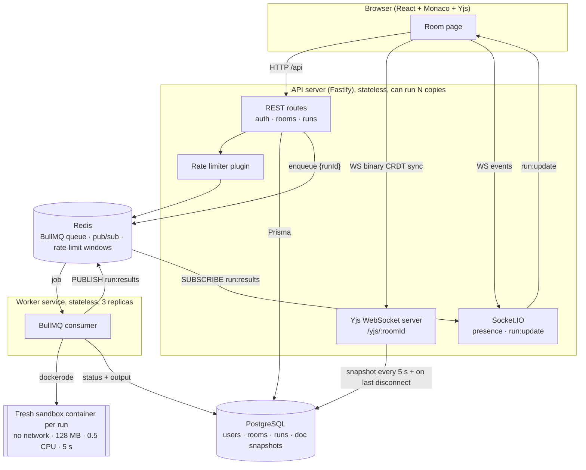
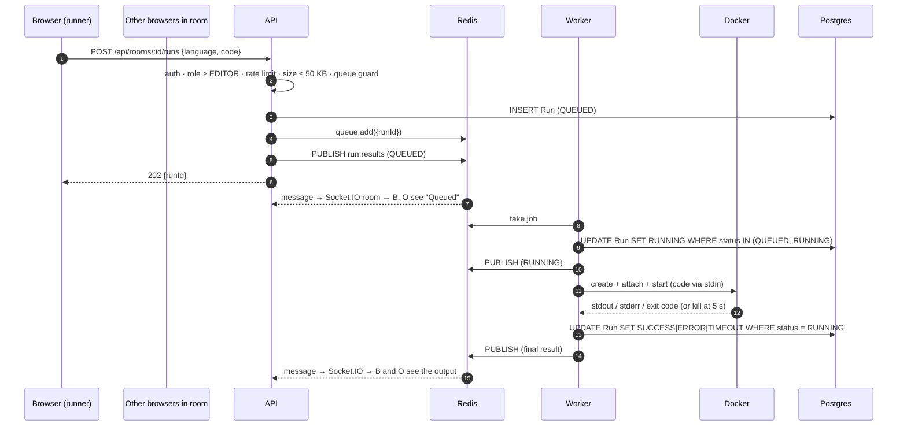
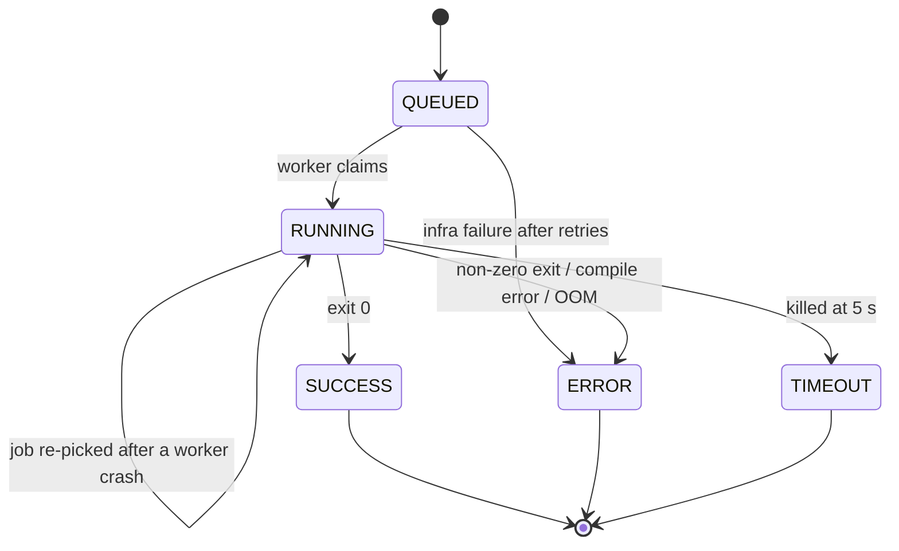

# Architecture

## System diagram



## Run flow



## Run state machine



The state machine is defined once in `packages/shared/src/run-state.ts`. The worker enforces it in the database with conditional updates (`UPDATE … WHERE status IN (<legal sources>)`), so a duplicate or late message can never overwrite a finished run, even with many workers.

## Real-time document sync

- Each room has one `Y.Doc` in the API process while anyone is connected. The editor text is a `Y.Text` named `monaco`.
- The browser binds Monaco to that `Y.Text` with `y-monaco`. Edits are applied locally first (so there's no typing lag), then sent as tiny binary updates.
- The server is a y-websocket-compatible implementation (`apps/server/src/realtime/yjs`) with additions the reference server doesn't have:
  - **Cookie auth during the HTTP upgrade**: no valid JWT → `401`, not a member → `403`, before any WebSocket is opened.
  - **Read-only viewers**: sync-step-1 ("send me the doc") is answered; their updates are dropped.
  - **Persistence**: `Y.encodeStateAsUpdate(doc)` is written to `DocSnapshot`, throttled to once per 5 s while edits flow, and immediately when the last client leaves. The next connection loads it, so a server restart loses at most ~5 s of edits.
  - **Starter code** is inserted on the server when a room's doc is first created. There is exactly one writer, so two clients can't both insert it.
- Cursors and presence use Yjs **awareness**. It is ephemeral, never persisted, and cleaned up when a socket closes.

## Why two WebSocket channels?

|                 | Yjs WebSocket (`/yjs/:roomId`) | Socket.IO                                |
| --------------- | ------------------------------ | ---------------------------------------- |
| Carries         | CRDT document updates, cursors | run status, presence list, room settings |
| Format          | compact binary (y-protocols)   | JSON events                              |
| Source of truth | the in-memory `Y.Doc`          | Postgres + Redis pub/sub                 |

They are separate so each protocol stays simple: y-websocket clients expect the exact Yjs wire format, and app events benefit from Socket.IO's rooms, acks and reconnection.

## Code layout

```
apps/server/src
├── config/env.ts            # Zod-validated env, fail fast
├── app.ts                   # composition root (wires repos → services → routes)
├── modules/<feature>/       # routes → service → repository
├── plugins/                 # auth guard, error handler, rate limiter
└── realtime/                # Yjs server, Socket.IO
apps/worker/src
├── sandbox/options.ts       # the security policy, one pure (tested) function
├── sandbox/runner.ts        # create → attach → start → wait/kill → collect
├── jobs/                    # job processing + conditional DB updates
└── index.ts                 # BullMQ worker, graceful drain, leftover cleanup
packages/shared              # Zod schemas, types, constants, run state machine
packages/db                  # Prisma schema, migrations, client
```
